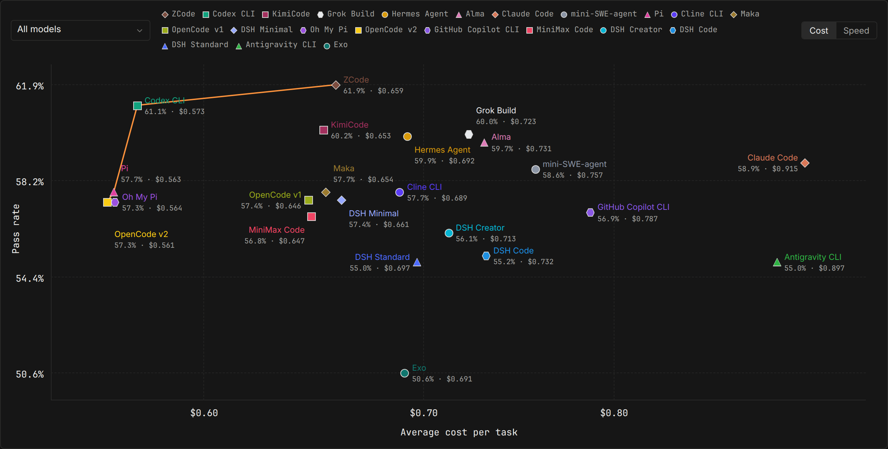

<h1 align="center">FrontierHarness Eval</h1>

<p align="center">
  <a href="https://frontierharness.org/leaderboard/v1.1/"></a>
  
  
  
  
  
</p>

<p align="center">
  <a href="https://frontierharness.org/leaderboard/v1.1/"><strong>Explore the live results →</strong></a>
  &nbsp;·&nbsp;
  <a href="#evaluate-your-own-harness"><strong>Evaluate your own harness →</strong></a>
</p>

<div align="center">
  <a href="https://frontierharness.org/leaderboard/v1.1/">
    
  </a>
</div>

### Full results

All five models, 1,240 scored attempts per configuration, cheapest first. The [interactive report](https://frontierharness.org/leaderboard/v1.1/) shows each model and task.

| Harness | Cost per pass | Pass rate | Cache hit rate | Time per pass | Version |
| --- | --- | --- | --- | --- | --- |
| **Codex CLI** | **$0.937** | 61.1% | 93.9% | 43m 48s | `0.164.0` |
| Pi | $0.976 | 57.7% | 94.5% | 54m 01s | `1.4.0` |
| OpenCode v2 | $0.978 | 57.3% | 94.3% | **43m 43s** | `2.2.7` |
| Oh My Pi | $0.983 | 57.3% | 93.1% | 59m 13s | `18.12.6` |
| ZCode | $1.06 | **61.9%** | 92.0% | 57m 08s | `0.17.0` |
| KimiCode | $1.09 | 60.2% | 93.3% | 56m 04s | `2.3.1` |
| OpenCode v1 | $1.12 | 57.4% | 94.6% | 1h 02m | `1.19.4` |
| Maka | $1.13 | 57.7% | 91.5% | 57m 30s | `0.2.2-dev.92.20261019` |
| MiniMax Code | $1.14 | 56.8% | 92.3% | 1h 00m | `0.6.13` |
| DSH Minimal | $1.15 | 57.4% | 95.1% | 1h 03m | `0.2.1-rc.3` |
| Hermes Agent | $1.16 | 59.9% | 93.0% | 58m 26s | `0.22.5` |
| Cline CLI | $1.19 | 57.7% | 86.4% | 1h 01m | `3.0.73` |
| Grok Build | $1.20 | 60.0% | 92.4% | 1h 00m | `1.0.67` |
| Alma | $1.22 | 59.7% | 91.0% | 57m 08s | `0.4.212` |
| DSH Creator | $1.27 | 56.1% | 95.5% | 1h 07m | `0.2.1-rc.3` |
| DSH Standard | $1.27 | 55.0% | 94.6% | 1h 05m | `0.2.1-rc.3` |
| mini-SWE-agent | $1.29 | 58.6% | 94.7% | 59m 32s | `2.4.6` |
| DSH Code | $1.32 | 55.2% | 94.5% | 1h 06m | `0.2.1-rc.3` |
| Exo | $1.36 | 50.6% | 91.1% | 1h 07m | `825318306c0e` |
| GitHub Copilot CLI | $1.38 | 56.9% | 88.6% | 1h 04m | `1.0.103` |
| Claude Code | $1.55 | 58.9% | 94.3% | 1h 10m | `2.1.308` |
| Antigravity CLI | $1.63 | 55.0% | **95.6%** | 1h 06m | `1.4.6` |

### Supplementary experiments

[GLM-5.3-Flash across four harnesses](results/supplementary/2026-09-glm-5.3-flash/README.md)
reports 120 contributor-run trials on the same task set. It includes task-level
comparisons and reproduction metadata, with model and runtime differences marked
explicitly. These results are separate from the published Kimi K3 leaderboard.

## What is in this repository

```text
datasets/  # Harbor manifest and publication record
suites/    # Baseten suite (Harbor job config)
adapters/  # Runta environment with the model proxy, and a command agent
scripts/   # Suite launcher
```

## Evaluate your own harness

This procedure, from [frontierharness.org](https://frontierharness.org/leaderboard/v1.1/), runs the `oracle` agent on one task to test your setup.

1. Install uv, Harbor and the Runta CLI:

```bash
curl -LsSf https://astral.sh/uv/install.sh | sh
uv tool install "harbor[runta]"
npm install -g @runta/runta-cli   # macOS: brew install runta-dev/tap/runta
```

2. Sign in to Runta:

```bash
runta login
export RUNTA_CONFIG=~/.config/runta/config.toml
```

3. Run one task:

```bash
harbor run -d frontier-harness-eval/frontier-harness-eval@v1.1.0 -a oracle -e runta -l 1 --override-storage-mb 32768
```

4. Show the results:

```bash
harbor view jobs
```

To test your harness, replace `-a oracle` with your Harbor agent. To run all 62 tasks, remove `-l 1`.

## How to run it

### Let an agent drive it

Give this prompt to a coding agent:

```text
Install uv, then Harbor (`uv tool install "harbor[runta]"`) and the Runta CLI (`brew install runta-dev/tap/runta` on macOS, `npm install -g @runta/runta-cli` on Linux). If `runta ps` fails, ask me to run `runta login`. Then run:

export RUNTA_CONFIG=~/.config/runta/config.toml
harbor run -d frontier-harness-eval/frontier-harness-eval@v1.1.0 -a oracle -e runta -l 1 --override-storage-mb 32768

Report whether the task passed and the job folder under ./jobs/.
```

<details>
<summary><strong>Run the Baseten suite</strong></summary>

The suite has all 22 configurations, in the order of the results table, at the published versions.

- Harbor built-in agents run 10 of them: Codex CLI, Pi, KimiCode, OpenCode v1, MiniMax Code, Grok Build, mini-SWE-agent, GitHub Copilot CLI, Claude Code and Antigravity CLI. Harbor installs the latest Antigravity CLI; it cannot pin `1.4.6`.
- `adapters/command_agent.py` runs the other 12 from install and run scripts in the suite: OpenCode v2, Oh My Pi, ZCode, Maka, Hermes Agent, Cline CLI, Alma, Exo and the four DSH profiles.
- Each runtime starts a LiteLLM proxy on `127.0.0.1:4011`. It accepts OpenAI, Anthropic and Gemini requests, sends them to Baseten, and sets effort `max` and 131,072 output tokens. Requests for fewer than 1,024 tokens keep their limit.
- Alma and Exo need source archives that are not in this repository: `jobs/alma-source-0.4.212.tar.gz` and `jobs/exo-825318306c0e.tar.gz`. Without them, the launcher leaves the two configurations out and shows a warning.

In `suites/baseten-eval.json`, `agent_defaults` applies to all agents, a list item `"@name"` inserts the snippet `name`, and `{alias}` and `{model_id}` change to the model for each job.

1. Install from the repository root:

```bash
uv sync --locked
```

2. Set two environment variables. Runta puts your Baseten key into each model request, so the key never goes into the runtime.

```bash
export RUNTA_MODEL_PROVIDER=<runta-baseten-provider-id>
export PROVIDER_STUB_KEY=<any-non-secret-placeholder>
```

3. Do a dry run (5,456 trials per model, or 4,960 without Alma and Exo):

```bash
uv run python scripts/run_baseten_eval.py --dry-run
uv run python scripts/run_baseten_eval.py --model kimi-k3 --tasks '*/fix-git' --attempts 1 --dry-run   # smoke test
```

4. Start the run:

```bash
uv run python scripts/run_baseten_eval.py
```

</details>

## Keeping a result comparable

- Use the pinned `frontier-harness-eval/frontier-harness-eval@v1.1.0` dataset.
- Use one of the five models on Baseten at effort `max`, with 131,072 output tokens per request at most.
- Use a new Runta runtime per trial, with the task's vCPU, memory and timeout, and a 32 GB disk.
- Score 4 attempts per task. Run infrastructure errors again; do not score them.

## Methodology

- **Tasks:** 62 command-line tasks in one Harbor dataset.
- **Models:** GLM-5.3, GLM-5.3-Flash, DeepSeek-V4.1-Flash-1017, Muse Spark Open and Kimi-K3 on Baseten.
- **Trials:** 62 tasks × 22 configurations × 4 attempts × 5 models = 27,280.
- **Runtime:** 1–4 vCPU, 2–8 GB memory, 32 GB disk, 15-minute to 8-hour agent timeout.
- **Scoring:** pass rate is verifier passes divided by scored attempts. Timeouts get a grade. Reward hacking is a fail.
- **Cost:** list price × reported tokens.

## Use the data

```bash
grep -A1 '^name = ' datasets/dataset.toml   # task packages and digests
```

To get a task definition, use `harbor download <package>@<digest>`.

## Sponsor

Runta supplied the isolated runtimes for all 27,280 trials.

<p align="center">
  <a href="https://runta.com"></a>
</p>
